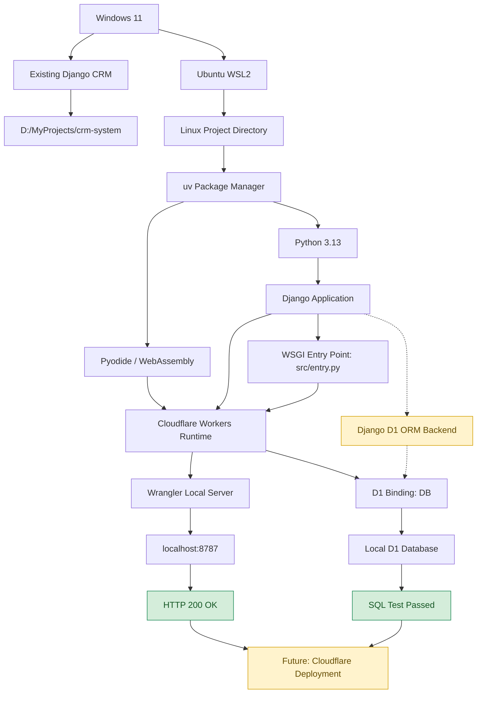
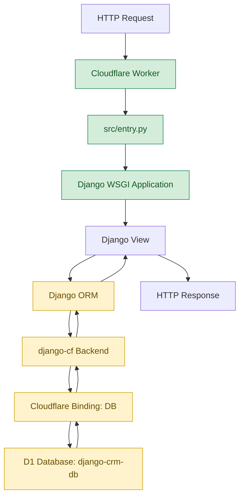
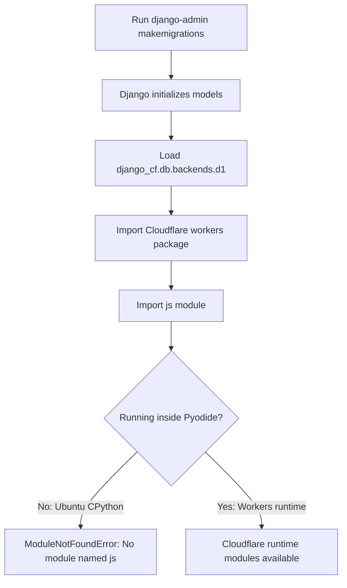
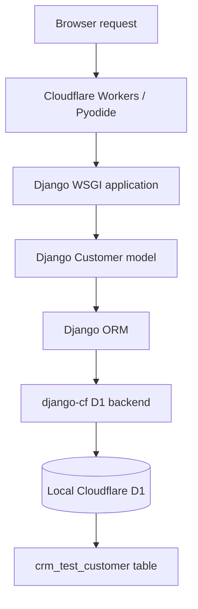
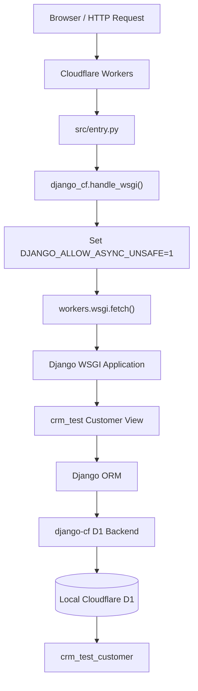

<<<<<<< HEAD
# Django WSGI Example

[](https://deploy.workers.cloudflare.com/?url=https://github.com/cloudflare/python-workers-examples/tree/main/django)

This example runs a small, conventional Django project directly on Cloudflare Workers using Django's WSGI application.

## How to Run

First ensure that `uv` is installed:
https://docs.astral.sh/uv/getting-started/installation/#standalone-installer

Run:

```sh
uv run pywrangler dev
```

Then try:

```sh
curl http://localhost:8787/
```

You should receive:

```json
{"message": "Hello from Django on Cloudflare Workers!"}
```

You can also deploy with:

```sh
uv run pywrangler deploy
```
=======
# Django on Cloudflare Workers — Setup & Troubleshooting Guide

**Environment:** Windows 11 + Ubuntu WSL2 + Python + Django + Cloudflare Workers + D1  
**Project:** `django-cloudflare-test`  
**Status:** ✅ Django local server working | ✅ D1 local SQL test passed | 🔄 Django ORM integration in progress  
**Last updated:** October 14, 2026

## Table of Contents

1. [System Architecture](#1-system-architecture)
2. [Complete Setup and Troubleshooting Flowchart](#2-complete-setup-and-troubleshooting-flowchart)
3. [Development Environment](#3-development-environment)
4. [Installation Commands](#4-installation-commands)
5. [Troubleshooting Reference](#5-troubleshooting-reference)
6. [Successful Test Results](#6-successful-test-results)
7. [Cloudflare D1 and Django ORM Integration](#7-cloudflare-d1-and-django-orm-integration)
8. [Next Steps — CRM Integration and Deployment](#8-next-steps--crm-integration-and-deployment)
9. [Django Customer Model and D1 Migration Testing](#9-django-customer-model-and-d1-migration-testing)
   - [9.1 Objective](#91-objective)
   - [9.2 Create the Django Application](#92-create-the-django-application)
   - [9.3 Define the Customer Model](#93-define-the-customer-model)
   - [9.4 Problem: Django Migration Command Fails](#94-problem-django-migration-command-fails)
   - [9.5 Solution: Temporary SQLite Configuration for Migration Generation](#95-solution-temporary-sqlite-configuration-for-migration-generation)
   - [9.6 Generate the Customer Migration](#96-generate-the-customer-migration)
   - [9.7 Verify Migration Consistency](#97-verify-migration-consistency)
   - [9.8 Create the Customer Table in Local Cloudflare D1](#98-create-the-customer-table-in-local-cloudflare-d1)
   - [9.9 Verify the Local D1 Table](#99-verify-the-local-d1-table)
   - [9.10 Planned Django ORM Test](#910-planned-django-orm-test)
   - [9.11 Progress Summary](#911-progress-summary)
   - [9.12 Key Lessons Learned](#912-key-lessons-learned)


10. [Django ORM Integration with Cloudflare D1 — Debugging and Successful Testing](#10-django-orm-integration-with-cloudflare-d1--debugging-and-successful-testing)
    - [10.1 Objective](#101-objective)
    - [10.2 Initial Problem — HTTP 500 Internal Server Error](#102-initial-problem--http-500-internal-server-error)
    - [10.3 Verify Cloudflare D1 Configuration](#103-verify-cloudflare-d1-configuration)
    - [10.4 Diagnose the Django ORM Error](#104-diagnose-the-django-orm-error)
    - [10.5 Temporary Workaround — DJANGO_ALLOW_ASYNC_UNSAFE](#105-temporary-workaround--django_allow_async_unsafe)
    - [10.6 Successful Customer Creation and Retrieval](#106-successful-customer-creation-and-retrieval)
    - [10.7 Inspect Cloudflare Workers WSGI Implementation](#107-inspect-cloudflare-workers-wsgi-implementation)
    - [10.8 Inspect django-cf Database Backend](#108-inspect-django-cf-database-backend)
    - [10.9 Discovery — django-cf Already Provides handle_wsgi()](#109-discovery--django-cf-already-provides-handle_wsgi)
    - [10.10 Update src/entry.py to Use django-cf](#1010-update-srcentrypy-to-use-django-cf)
    - [10.11 Final Test Results](#1011-final-test-results)
    - [10.12 Development Progress](#1012-development-progress)
    - [10.13 Lessons Learned](#1013-lessons-learned)
    - [10.14 Next Development Tasks](#1014-next-development-tasks)

---

## 1. System Architecture

The development environment uses Windows 11 for the original Django CRM project and Ubuntu WSL2 for the Cloudflare Workers development runtime.



### Current architecture

| Layer | Technology | Status |
|---|---|---|
| Operating system | Windows 11 | Working |
| Linux development | Ubuntu WSL2 | Working |
| Python package manager | uv | Working |
| Python runtime | Python 3.13 / Pyodide | Working |
| Web framework | Django | Working locally |
| Worker entry point | WSGI via `src/entry.py` | Verified |
| Cloudflare development server | Wrangler | Working |
| Database service | Cloudflare D1 | Created |
| Local database SQL | Wrangler D1 commands | Tested |
| Django D1 backend | `django-cf` 0.2.17 | Installed and configured |
| Django ORM CRUD | Django models and queries | Not yet tested |
| Public deployment | Cloudflare Workers | Not yet deployed |

**Important:** The D1 database exists and local SQL operations have succeeded. However, Django ORM connectivity has not yet been verified.

[⬆ Back to Table of Contents](#table-of-contents)

---

## 2. Complete Setup and Troubleshooting Flowchart

This diagram records the actual development process, problems encountered, solutions, and current progress.


[⬆ Back to Table of Contents](#table-of-contents)

---

## 3. Development Environment

### Windows environment

| Component | Version / Location |
|---|---|
| Operating system | Windows 11 |
| Project root | `D:\MyProjects` |
| Existing CRM | `D:\MyProjects\crm-system` |
| Cloudflare test project | `D:\MyProjects\django-cloudflare-test` |
| Windows Python | 3.13.7 |
| Windows uv | 0.13.0 |
| Node.js after upgrade | 24.x |
| WSL distribution | Ubuntu, WSL2 |

### Ubuntu environment

| Component | Version / Location |
|---|---|
| Ubuntu Python | 3.14.4 |
| Project Python | 3.13, managed by uv |
| Node.js | 24.21.0 |
| npm | 11.19.0 |
| Wrangler | 4.149.0 |
| Django in generated test project | 6.1.2 |
| Django Cloudflare backend | `django-cf` 0.2.17 |
| Project location | `/home/potatoscript/projects/django-cloudflare-test` |
| Development URL | `http://localhost:8787` |
| D1 database name | `django-crm-db` |
| D1 binding name | `DB` |

The original CRM uses Django 5.2. Its compatibility with the Cloudflare runtime must be tested separately.

[⬆ Back to Table of Contents](#table-of-contents)

---

## 4. Installation Commands

### 4.1 Create the project on Windows

Upgrade Node.js if necessary:

```cmd
winget upgrade --id OpenJS.NodeJS.LTS -e
```

Verify:

```cmd
node --version
npm --version
```

Create the Django Cloudflare test project:

```cmd
cd /d D:\MyProjects

uv run --with workers-py pywrangler init django-cloudflare-test --template https://github.com/cloudflare/python-workers-examples/tree/main/django
```

During initialization:

- Choose **Yes** to create `AGENTS.md`.
- Choose **Yes** to initialize Git.
- Do not deploy yet.

### 4.2 Start Ubuntu WSL2

From Windows Command Prompt:

```cmd
wsl -l -v
wsl -d Ubuntu
```

Verify Ubuntu is running:

```bash
pwd
```

### 4.3 Install Node.js in Ubuntu

Install prerequisites:

```bash
sudo apt update
sudo apt install -y curl ca-certificates
```

Install nvm:

```bash
curl -o- https://raw.githubusercontent.com/nvm-sh/nvm/v0.40.3/install.sh | bash
```

Load nvm:

```bash
export NVM_DIR="$HOME/.nvm"
[ -s "$NVM_DIR/nvm.sh" ] && . "$NVM_DIR/nvm.sh"
```

Install Node.js 24:

```bash
nvm install 24
```

Verify:

```bash
node --version
npm --version
```

### 4.4 Install uv in Ubuntu

```bash
curl -LsSf https://astral.sh/uv/install.sh | sh
source ~/.local/bin/env
uv --version
```

### 4.5 Mount the Windows D: drive

Check:

```bash
ls /mnt/d
```

If the directory does not exist:

```bash
sudo mkdir -p /mnt/d
sudo mount -t drvfs D: /mnt/d
```

Verify:

```bash
ls /mnt/d/MyProjects
```

### 4.6 Copy the Cloudflare project to Ubuntu

Create the destination:

```bash
mkdir -p ~/projects/django-cloudflare-test
cd ~/projects/django-cloudflare-test
```

Copy source files while excluding Windows-generated environments:

```bash
tar -C /mnt/d/MyProjects/django-cloudflare-test \
  --exclude=.venv \
  --exclude=.venv-workers \
  --exclude=node_modules \
  --exclude=.git \
  -cf - . | tar -xf -
```

Verify:

```bash
ls -la
```

Expected project files include:

```text
django-cloudflare-test/
├── AGENTS.md
├── README.md
├── package.json
├── package-lock.json
├── pyproject.toml
├── uv.lock
├── wrangler.jsonc
└── src/
```

### 4.7 Install Python dependencies

```bash
uv python install 3.13
uv sync --python 3.13
```

### 4.8 Start the Cloudflare development server

```bash
uv run --with workers-py pywrangler dev
```

Open:

http://localhost:8787

**Expected response:**

```json
{
  "message": "Hello from Django on Cloudflare Workers!"
}
```

[⬆ Back to Table of Contents](#table-of-contents)

---

## 5. Troubleshooting Reference

### Error 1 — Incorrect command syntax

**Error:**

```text
No interpreter found for executable name `y`
```

**Cause:** Accidentally entered `workers -py` with a space.

**Incorrect:**

```bash
uv run --with workers -py pywrangler init
```

**Correct:**

```bash
uv run --with workers-py pywrangler init
```

### Error 2 — Node.js version too old

**Error:**

```text
create-cloudflare requires at least Node.js v22.0.0
You are using v20.20.0
```

**Solution:** Upgrade Node.js to version 22 or newer.

On Windows:

```cmd
winget upgrade --id OpenJS.NodeJS.LTS -e
```

Restart the terminal and verify:

```cmd
node --version
```

### Error 3 — Hardlink warning during installation

**Warning:**

```text
Failed to hardlink files; falling back to full copy.
```

**Cause:** uv could not use hard links between its cache and the target virtual environment.

**Solution:**

```cmd
set UV_LINK_MODE=copy
```

Or:

```cmd
uv sync --link-mode copy
```

This warning is not fatal. Copy mode may be slower.

### Error 4 — Installation appears stuck at `Installing wheels`

**Example:**

```text
[13/14] tzdata==2026.5
```

Or:

```text
[0/1] Installing wheels...
```

**Investigation:**

```cmd
uv sync --offline --link-mode copy -vv
```

The verbose logs eventually showed:

```text
TRACE Extracting wheel files name=PackageName("django")
TRACE Writing record name=PackageName("django")
Installed 1 package in 2m 31s
+ django==6.1.2
```

**Lesson:** A large Python package installation may appear frozen while files are being extracted and installed. Wait for completion and inspect verbose output before assuming failure.

### Error 5 — Pyodide runtime fails on Windows

**Error:**

```text
ModuleNotFoundError: No module named 'python'
```

During:

```text
.venv-workers
pyodide-3.13.2-emscripten-wasm32-musl
```

**Cause:** The Windows Cloudflare development environment could not successfully initialize or inspect its Pyodide interpreter. The exact underlying cause was not established.

**Attempted repair:**

```cmd
uv python install pyodide-3.13.2-emscripten-wasm32-musl --reinstall
```

This failed with:

```text
No download found for request
```

**Working alternative:** Run the project inside Ubuntu WSL2. This successfully initialized Pyodide and started Wrangler.

### Error 6 — Node.js not found in Ubuntu

**Error:**

```text
node: command not found
```

**Cause:** Windows and Ubuntu maintain separate development environments.

**Solution:** Install Node.js inside Ubuntu using nvm.

```bash
nvm install 24
```

### Error 7 — uv not found in Ubuntu

**Error:**

```text
uv: command not found
```

**Solution:**

```bash
curl -LsSf https://astral.sh/uv/install.sh | sh
source ~/.local/bin/env
```

### Error 8 — Windows D: drive unavailable

**Error:**

```text
ls: cannot access '/mnt/d': No such file or directory
```

**Solution:**

```bash
sudo mkdir -p /mnt/d
sudo mount -t drvfs D: /mnt/d
```

Verify:

```bash
ls /mnt/d/MyProjects
```

### Error 9 — tar cannot find source directory

**Error:**

```text
tar: /mnt/d/MyProjects/django-cloudflare-test:
Cannot open: No such file or directory
```

**Cause:** The Windows D: drive was not mounted in Ubuntu.

**Solution:** Mount the drive first, verify the directory exists, and repeat the copy command.

### Error 10 — favicon.ico returns 404

**Log:**

```text
GET /favicon.ico 404 Not Found
```

**Cause:** The browser requested a favicon that the Django example does not provide.

**Action:** No action required for the test project. Add a favicon later if desired.

### Error 11 — Cloudflare entry point file not found

**Error:**

```text
cat: src/index.py: No such file or directory
```

**Cause:** The generated project uses `src/entry.py` instead of `src/index.py`.

**Solution:**

```bash
find src -name "entry.py"
cat src/entry.py
```

The confirmed entry point is `src/entry.py`.

### Error 12 — D1 configuration grep returns no output

**Incorrect command:**

```bash
grep -n -A 7 '"d1_database"' wrangler.jsonc
```

**Cause:** The Wrangler configuration property is `d1_databases`, plural.

**Correct command:**

```bash
grep -n -A 8 '"d1_databases"' wrangler.jsonc
```

If no output appears, inspect the complete file:

```bash
cat wrangler.jsonc
```

### Error 13 — Django database backend cannot be imported

**Possible error:**

```text
ModuleNotFoundError: No module named 'django_cf'
```

**Check whether the package is installed:**

```bash
uv pip show django-cf
```

**Install if missing:**

```bash
uv add django-cf
```

This is a troubleshooting reference; this particular error has not occurred in the current project.

[⬆ Back to Table of Contents](#table-of-contents)

---

## 6. Successful Test Results

### 6.1 Django local server

**Terminal output:**

```text
wrangler 4.149.0

Packages installed in python_modules.
Packages installed in .venv-workers.

Ready on http://localhost:8787

GET / 200 OK (194ms)
GET /favicon.ico 404 Not Found
```

**Browser response:**

```json
{
  "message": "Hello from Django on Cloudflare Workers!"
}
```

### 6.2 Cloudflare D1 SQL test

Created the test table:

```bash
npx wrangler d1 execute django-crm-db --local --command "CREATE TABLE IF NOT EXISTS connection_test (id INTEGER PRIMARY KEY, message TEXT NOT NULL)"
```

Inserted a record:

```bash
npx wrangler d1 execute django-crm-db --local --command "INSERT INTO connection_test (message) VALUES ('Django Cloudflare D1 test')"
```

Retrieved the record:

```bash
npx wrangler d1 execute django-crm-db --local --command "SELECT * FROM connection_test"
```

**Confirmed result:** The SQL query returned the inserted message.

```text
Django Cloudflare D1 test
```

This proves that local D1 SQL operations work. It does not yet prove Django's ORM can access the database.

### 6.3 Verified milestones

| Milestone | Status |
|---|---|
| Ubuntu WSL2 starts | Complete |
| Node.js works in Ubuntu | Complete |
| uv installs Python dependencies | Complete |
| Pyodide initializes | Complete |
| Django returns HTTP 200 | Complete |
| Cloudflare D1 database created | Complete |
| Local D1 SQL insert/select | Complete |
| `django-cf` installed | Complete |
| Django D1 settings configured | Complete |
| WSGI entry point inspected | Complete |
| D1 binding configuration rechecked | Pending |
| Django ORM CRUD tested | Pending |
| Cloudflare public deployment | Pending |

[⬆ Back to Table of Contents](#table-of-contents)

---

## 7. Cloudflare D1 and Django ORM Integration

### 7.1 Create a Cloudflare D1 database

From Ubuntu:

```bash
cd ~/projects/django-cloudflare-test
```

Authenticate with Cloudflare:

```bash
npx wrangler login
```

Create the database:

```bash
npx wrangler d1 create django-crm-db --binding DB --update-config
```

The database name is:

```text
django-crm-db
```

The Cloudflare Worker binding is:

```text
DB
```

### 7.2 Check `wrangler.jsonc`

**File:** `wrangler.jsonc`

Expected configuration section:

```json
"d1_databases": [
  {
    "binding": "DB",
    "database_name": "django-crm-db",
    "database_id": "YOUR_ACTUAL_DATABASE_ID"
  }
]
```

The actual database ID is generated by Cloudflare.

Check the configuration:

```bash
grep -n -A 8 '"d1_databases"' wrangler.jsonc
```

**Status:** Database creation and SQL operations succeeded. The final configuration verification is still pending.

### 7.3 Install the Django Cloudflare backend

```bash
uv add django-cf
```

Verify:

```bash
uv pip show django-cf
```

**Actual result:**

```text
Name: django-cf
Version: 0.2.17
Location: /home/potatoscript/projects/django-cloudflare-test/.venv/lib/python3.13/site-packages
Requires: sqlparse, workers-runtime-sdk
```

**Status:** Successfully installed.

### 7.4 Configure Django to use D1

**File:** `src/hello_django/settings.py`

The current database configuration is:

```python
DATABASES = {
    "default": {
        "ENGINE": "django_cf.db.backends.d1",
        "CLOUDFLARE_BINDING": "DB",
    }
}
```

Verify:

```bash
grep -n -A 7 'DATABASES' src/hello_django/settings.py
```

**Actual result:**

```text
9:DATABASES = {
10-     "default":{
11-             "ENGINE": "django_cf.db.backends.d1",
12-             "CLOUDFLARE_BINDING": "DB",
13-     }
14-}
```

**Status:** Successfully configured.

### 7.5 Verify the Django Worker entry point

**File:** `src/entry.py`

The project uses WSGI rather than ASGI.

Actual file contents:

```python
import os

from workers import WorkerEntrypoint, wsgi

os.environ.setdefault("DJANGO_SETTINGS_MODULE", "hello_django.settings")

from hello_django.wsgi import application


class Default(WorkerEntrypoint):
    async def fetch(self, request):
        return await wsgi.fetch(application, request, self.env)
```

The entry point performs these operations:

1. Imports the Cloudflare Workers runtime.
2. Sets the Django settings module.
3. Imports Django's WSGI application.
4. Defines the Worker entry point.
5. Forwards incoming HTTP requests to Django.
6. Passes Cloudflare environment bindings through `self.env`.

**Status:** Verified. No changes required.

### 7.6 D1 connection flow



The Django ORM portion of this flow is the intended architecture and remains to be tested.

### 7.7 Next test — Django Customer model

The planned model is:

```python
from django.db import models


class Customer(models.Model):
    name = models.CharField(max_length=100)
    email = models.EmailField()

    def __str__(self):
        return self.name
```

Planned ORM operations:

```python
Customer.objects.create(
    name="Cloudflare Test Customer",
    email="test@example.com"
)
```

```python
Customer.objects.all()
```

These examples have **not yet been executed**.

Before running migrations, confirm the supported migration workflow for the installed D1 backend. Cloudflare D1 has transaction limitations, and standard Django migration behavior should not be assumed to work unchanged.

[⬆ Back to Table of Contents](#table-of-contents)

---

## 8. Next Steps — CRM Integration and Deployment

### Phase 1 — Complete Django ORM integration

- [x] Create D1 database
- [x] Test local SQL operations
- [x] Install `django-cf`
- [x] Configure Django database settings
- [x] Verify the WSGI entry point
- [ ] Verify `DB` binding in `wrangler.jsonc`
- [ ] Restart Django with the D1 configuration
- [ ] Create a test Django app and Customer model
- [ ] Generate and apply compatible migrations
- [ ] Test Django ORM create, read, update, and delete

### Phase 2 — Integrate the existing CRM

- [ ] Review the existing Django 5.2 CRM project
- [ ] Verify compatibility with the Cloudflare Django runtime
- [ ] Migrate Customer functionality
- [ ] Migrate Contact functionality
- [ ] Migrate Opportunity functionality
- [ ] Migrate Activity functionality
- [ ] Test relationships, forms, search, and pagination
- [ ] Configure authentication and access control

### Phase 3 — Deploy to Cloudflare

- [ ] Configure production settings and secrets
- [ ] Configure static assets
- [ ] Apply database schema changes to remote D1
- [ ] Deploy to a Cloudflare `workers.dev` address
- [ ] Test all CRM functions online
- [ ] Confirm the CRM works while the local PC is off
- [ ] Monitor Cloudflare free-tier usage and limits

### Important limitations

Cloudflare D1 does not support all transaction behavior expected by traditional Django database backends. Migration compatibility, Django ORM features, and free-tier resource limits must be tested before using this setup for production CRM data.

Do not use a production database for destructive tests or assume Django's test runner will automatically create an isolated D1 test database.

### Useful commands for future sessions

Start Ubuntu from Windows:

```cmd
wsl -d Ubuntu
```

Enter the project:

```bash
cd ~/projects/django-cloudflare-test
```

Verify the Django Cloudflare package:

```bash
uv pip show django-cf
```

Check Django database settings:

```bash
grep -n -A 7 'DATABASES' src/hello_django/settings.py
```

Check the D1 binding:

```bash
grep -n -A 8 '"d1_databases"' wrangler.jsonc
```

Inspect the Worker entry point:

```bash
cat src/entry.py
```

Query local D1:

```bash
npx wrangler d1 execute django-crm-db --local --command "SELECT * FROM connection_test"
```

Start the development server:

```bash
uv run --with workers-py pywrangler dev
```

Stop the development server:

```text
Ctrl+C
```

---

## Development Milestones

| Date | Achievement |
|---|---|
| October 11, 2026 | Django successfully ran locally through Cloudflare Workers on Ubuntu WSL2 |
| October 13, 2026 | Cloudflare D1 database created and local SQL operations verified |
| October 14, 2026 | `django-cf` 0.2.17 and Django D1 settings confirmed; WSGI entry point verified |

**Current milestone:** Preparing to test Django ORM operations with Cloudflare D1.

**Next milestone:** Create a Django Customer model and successfully save and retrieve data using Django ORM.

[⬆ Back to Table of Contents](#table-of-contents)

---


## 9. Django Customer Model and D1 Migration Testing

**Date:** October 14, 2026  
**Project:** `django-cloudflare-test`  
**Environment:** Ubuntu WSL2, Python 3.13, Django 6.1.2, Cloudflare Workers, Cloudflare D1

### 9.1 Objective

The next development milestone is to integrate Django's Object-Relational Mapper (ORM) with Cloudflare D1.

The initial test uses a simple `Customer` model containing a customer name and email address.

The goal is to:

1. Create a Django application named `crm_test`.
2. Define the `Customer` model.
3. Generate a Django migration.
4. Create the corresponding table in local Cloudflare D1.
5. Verify the database schema.
6. Prepare to test Django ORM operations inside Cloudflare Workers.

[⬆ Back to Table of Contents](#table-of-contents)

### 9.2 Create the Django Application

Navigate to the project directory:

```bash
cd ~/projects/django-cloudflare-test
```

Create the application directory and initialize the Django app:

```bash
mkdir -p src/crm_test
uv run django-admin startapp crm_test src/crm_test
```

Register the application in `src/hello_django/settings.py`:

```python
INSTALLED_APPS = [
    # Keep existing installed applications
    "crm_test",
]
```

### 9.3 Define the Customer Model

**File:** `src/crm_test/models.py`

```python
from django.db import models


class Customer(models.Model):
    name = models.CharField(max_length=100)
    email = models.EmailField()

    def __str__(self):
        return self.name
```

Django automatically provides a primary key when one is not explicitly defined.


[⬆ Back to Table of Contents](#table-of-contents)

### 9.4 Problem: Django Migration Command Fails

The initial migration command was:

```bash
PYTHONPATH=src uv run django-admin makemigrations crm_test --settings=hello_django.settings
```

It failed with:

```text
ModuleNotFoundError: No module named 'js'
```

Followed by:

```text
django.core.exceptions.ImproperlyConfigured:
'django_cf.db.backends.d1' isn't an available database backend
or couldn't be imported.
```

#### Root Cause

The Cloudflare D1 backend imports Cloudflare's `workers` package, which depends on the `js` module provided by Pyodide.

Standard CPython running inside Ubuntu does not provide this module.

Therefore, the error does not mean the `Customer` model is incorrect or that `django-cf` is necessarily missing.



[⬆ Back to Table of Contents](#table-of-contents)

### 9.5 Solution: Temporary SQLite Configuration for Migration Generation

**File:** `src/hello_django/settings.py`

Configure the database backend conditionally:

```python
import os

if os.environ.get("DJANGO_MIGRATION_GENERATION") == "1":
    DATABASES = {
        "default": {
            "ENGINE": "django.db.backends.sqlite3",
            "NAME": ":memory:",
        }
    }
else:
    DATABASES = {
        "default": {
            "ENGINE": "django_cf.db.backends.d1",
            "CLOUDFLARE_BINDING": "DB",
        }
    }
```

This separates two operations:

| Operation | Database backend |
|---|---|
| Generate migration files in Ubuntu | SQLite |
| Run Django inside Cloudflare Workers | Cloudflare D1 |

**Important:** The SQLite configuration is used only to generate migration files. It does not migrate or populate the Cloudflare D1 database.

[⬆ Back to Table of Contents](#table-of-contents)

### 9.6 Generate the Customer Migration

Run:

```bash
DJANGO_MIGRATION_GENERATION=1 PYTHONPATH=src uv run django-admin makemigrations crm_test --settings=hello_django.settings
```

The migration was generated successfully.

**Generated file:**

```text
src/crm_test/migrations/0001_initial.py
```

Actual generated content:

```python
# Generated by Django 6.1.2 on 2026-10-14 09:27

from django.db import migrations, models


class Migration(migrations.Migration):

    initial = True

    dependencies = [
    ]

    operations = [
        migrations.CreateModel(
            name='Customer',
            fields=[
                ('id', models.BigAutoField(
                    auto_created=True,
                    primary_key=True,
                    serialize=False,
                    verbose_name='ID'
                )),
                ('name', models.CharField(max_length=100)),
                ('email', models.EmailField(max_length=254)),
            ],
        ),
    ]
```

The migration defines the following table:

**Table name:** `crm_test_customer`

| Column | Django field | Purpose |
|---|---|---|
| `id` | `BigAutoField` | Automatically generated primary key |
| `name` | `CharField(max_length=100)` | Customer name |
| `email` | `EmailField(max_length=254)` | Customer email address |

### 9.7 Verify Migration Consistency

The migration command was executed again:

```bash
DJANGO_MIGRATION_GENERATION=1 PYTHONPATH=src uv run django-admin makemigrations crm_test --settings=hello_django.settings
```

**Actual result:**

```text
No changes detected in app 'crm_test'
```

**Status: SUCCESS**

This confirms that the current `Customer` model matches the generated migration definition.

It does **not** mean the database table has already been created.

### 9.8 Create the Customer Table in Local Cloudflare D1

The next planned step is to create the table using Wrangler.

```bash
cd ~/projects/django-cloudflare-test
```

```bash
npx wrangler d1 execute django-crm-db --local --command "CREATE TABLE IF NOT EXISTS crm_test_customer (id INTEGER PRIMARY KEY AUTOINCREMENT, name VARCHAR(100) NOT NULL, email VARCHAR(254) NOT NULL)"
```

This SQL creates a table corresponding to the test model.

**Note:** This is a manual schema creation test, not execution of Django's migration framework. It does not update Django's `django_migrations` history table.

The `--local` option ensures the operation targets the local development D1 database rather than the remote production database.

[⬆ Back to Table of Contents](#table-of-contents)

### 9.9 Verify the Local D1 Table

Check whether the table exists:

```bash
npx wrangler d1 execute django-crm-db --local --command "SELECT name FROM sqlite_master WHERE type='table' AND name='crm_test_customer'"
```

Expected table name:

```text
crm_test_customer
```

Inspect the table columns:

```bash
npx wrangler d1 execute django-crm-db --local --command "PRAGMA table_info(crm_test_customer)"
```

Expected columns:

- `id`
- `name`
- `email`

**Verification status:** Pending confirmation.

[⬆ Back to Table of Contents](#table-of-contents)

### 9.10 Planned Django ORM Test

Once the local D1 table has been verified, the next task is to test Django ORM operations from inside the Cloudflare Workers runtime.

Example record creation:

```python
from crm_test.models import Customer

Customer.objects.create(
    name="Cloudflare Test Customer",
    email="test@example.com",
)
```

Example record retrieval:

```python
customers = Customer.objects.all()
```

The test will use a local-only endpoint and avoid exposing an unauthenticated database-writing endpoint in a deployed application.



### 9.11 Progress Summary

| Task | Status |
|---|---|
| Create `crm_test` application | Completed |
| Define `Customer` model | Completed |
| Diagnose missing `js` module | Completed |
| Configure temporary SQLite migration backend | Completed |
| Generate `0001_initial.py` | Completed |
| Verify no model changes remain | Completed |
| Create Customer table in local D1 | Pending confirmation |
| Verify D1 table schema | Pending confirmation |
| Insert customer using Django ORM | Not started |
| Retrieve customer using Django ORM | Not started |
| Test remote Cloudflare D1 | Not started |
| Deploy Django CRM online | Not started |

### 9.12 Key Lessons Learned

**1. Cloudflare Workers Python is different from standard CPython.**

Cloudflare's Python runtime uses Pyodide and provides JavaScript interoperability modules that are not available in ordinary Ubuntu Python.

**2. `makemigrations` and `migrate` are different commands.**

- `makemigrations` generates migration definitions.
- `migrate` applies migrations to a database.

**3. Django migration files can be generated using SQLite.**

A temporary SQLite backend allows Django to generate model migration files without importing the Cloudflare D1 backend.

**4. Local D1 and remote D1 are separate environments.**

Wrangler's `--local` flag targets the local development database. Remote database operations require a separate, deliberate command.

**5. Manual SQL table creation is not equivalent to Django migrations.**

The manual SQL approach is useful for testing basic D1 connectivity, but a proper migration strategy is still required before deploying the full CRM.

**Next milestone:** Verify the local `crm_test_customer` table and test Django ORM read/write operations inside Cloudflare Workers.

[⬆ Back to Table of Contents](#table-of-contents)

---

# 10. Django ORM Integration with Cloudflare D1 — Debugging and Successful Testing

**Date:** October 16, 2026  
**Project:** Django on Cloudflare Workers  
**Development Environment:** Ubuntu WSL2 / Windows  
**Framework:** Django 6.1.2  
**Database:** Cloudflare D1 (`django-crm-db`)  
**Django D1 Backend:** `django-cf` 0.2.17  
**Workers Runtime SDK:** 1.9.3

## 10.1 Objective

The objective was to verify that Django's Object-Relational Mapper (ORM) could successfully communicate with Cloudflare D1 through Cloudflare Workers.

The tasks included:

1. Testing the Django Customer API.
2. Investigating an HTTP 500 error.
3. Verifying the D1 database configuration.
4. Diagnosing Django's asynchronous safety exception.
5. Testing Customer creation and retrieval.
6. Inspecting the Cloudflare Workers WSGI adapter.
7. Replacing the manual compatibility workaround with the `django-cf` helper.

## 10.2 Initial Problem — HTTP 500 Internal Server Error

After starting the Cloudflare Workers development server:

```bash
uv run --with workers-py pywrangler dev
```

The terminal displayed:

```text
[wrangler:info] Ready on http://localhost:8787
[wrangler:info] GET / 200 OK
[wrangler:info] GET /favicon.ico 404 Not Found
[wrangler:info] GET /customers 404 Not Found
[wrangler:info] GET /customers/ 500 Internal Server Error
```

The root endpoint worked, confirming that Django was running.

The `/customers` endpoint returned 404 because the URL pattern required a trailing slash.

The `/customers/` endpoint returned 500, indicating a server-side exception during Customer retrieval.

## 10.3 Verify Cloudflare D1 Configuration

Checked the local D1 table:

```bash
npx wrangler d1 execute django-crm-db --local --command "PRAGMA table_info(crm_test_customer)"
```

**Result: Successful**

| Column | Data type |
|---|---|
| id | INTEGER |
| name | VARCHAR(100) |
| email | VARCHAR(254) |

Checked the Wrangler D1 binding:

```bash
grep -n -A 8 '"d1_databases"' wrangler.jsonc
```

The configuration contained:

```json
"d1_databases": [
  {
    "binding": "DB",
    "database_name": "django-crm-db",
    "database_id": "24f02e3d-80c5-4b68-8e67-9b93848f8f97"
  }
]
```

The table existed, and the database binding was configured correctly.

## 10.4 Diagnose the Django ORM Error

Temporarily updated `src/crm_test/views.py` to return exception information:

```python
from django.http import JsonResponse
from .models import Customer


def customer_list(request):
    try:
        customers = list(
            Customer.objects.values("id", "name", "email")
        )

        return JsonResponse({
            "status": "success",
            "customers": customers,
        })

    except Exception as e:
        return JsonResponse({
            "status": "error",
            "error_type": type(e).__name__,
            "error_message": str(e),
        }, status=500)
```

The API returned:

```json
{
  "status": "error",
  "error_type": "SynchronousOnlyOperation",
  "error_message": "You cannot call this from an async context - use a thread or sync_to_async."
}
```

### Root Cause

Cloudflare Workers uses an asynchronous request handler:

```python
async def fetch(self, request):
    ...
```

Django's ORM contains safeguards against executing synchronous database operations within an asynchronous context.

The Cloudflare WSGI adapter executes the synchronous Django application from the asynchronous Workers handler.

As a result, Django raised `SynchronousOnlyOperation`.

## 10.5 Temporary Workaround — DJANGO_ALLOW_ASYNC_UNSAFE

For local testing, added the following environment variable to `src/entry.py` before importing Django:

```python
os.environ["DJANGO_ALLOW_ASYNC_UNSAFE"] = "true"
```

This bypassed Django's asynchronous safety restriction.

After restarting the development server, the Customer API returned:

```json
{
  "status": "success",
  "customers": []
}
```

**Result: Successful ORM read test**

The empty list indicated that the query executed successfully but no customer records were present.

**Important:** This setting disables Django's async-safety protection. It does not make synchronous ORM operations inherently safe under concurrency.

## 10.6 Successful Customer Creation and Retrieval

Added a temporary Customer creation endpoint using Django ORM:

```python
customer = Customer.objects.create(
    name="Cloudflare Test Customer",
    email="test@example.com",
)
```

The creation endpoint was tested with:

```bash
curl -i -X POST http://localhost:8787/customers/create/ \
  -H "Content-Type: application/json" \
  -d '{"name":"Cloudflare Test Customer","email":"test@example.com"}'
```

The Customer list endpoint then returned:

```json
{
  "status": "success",
  "customers": [
    {
      "id": 1,
      "name": "Cloudflare Test Customer",
      "email": "test@example.com"
    }
  ]
}
```

**Result: Successful ORM write-and-read test**

This confirmed that Django ORM could create and retrieve a Customer record through the configured D1 backend in the local Workers environment.

The creation endpoint used `csrf_exempt` for testing and must be secured or removed before public deployment.

## 10.7 Inspect Cloudflare Workers WSGI Implementation

Attempted to inspect the WSGI adapter using standard Python:

```bash
uv run python -c "import inspect; from workers import wsgi; print(inspect.getfile(wsgi))"
```

The command failed:

```text
ModuleNotFoundError: No module named 'js'
```

This occurs because the Cloudflare Workers Python package depends on the Pyodide-provided `js` module, which is unavailable in ordinary Ubuntu CPython.

Instead, located the source file without importing it:

```bash
find .venv/lib/python3.13/site-packages/workers -iname '*wsgi*'
```

Result:

```text
.venv/lib/python3.13/site-packages/workers/wsgi.py
```

Inspected the file:

```bash
sed -n '1,240p' \
  .venv/lib/python3.13/site-packages/workers/wsgi.py
```

The source describes how the adapter bridges synchronous WSGI operations with the asynchronous Workers runtime using Pyodide's JSPI capabilities.

## 10.8 Inspect django-cf Database Backend

Located the shared database wrapper:

```bash
grep -R -n 'class CFDatabaseWrapper' \
  .venv/lib/python3.13/site-packages/django_cf
```

Result:

```text
django_cf/db/base_engine.py:464:
class CFDatabaseWrapper(SQLiteDatabaseWrapper):
```

Inspected the implementation:

```bash
sed -n '450,550p' \
  .venv/lib/python3.13/site-packages/django_cf/db/base_engine.py
```

Important implementation details:

```python
class CFDatabaseWrapper(SQLiteDatabaseWrapper):
    transaction_modes = frozenset([])

    def _savepoint_allowed(self):
        return False

    def _start_transaction_under_autocommit(self):
        return
```

### Findings

The backend is based on Django's SQLite database wrapper but adapts its behavior for Cloudflare storage.

The inspected implementation disables savepoints and does not start ordinary interactive transactions.

This is important when designing CRM operations involving multiple related records.

## 10.9 Discovery — django-cf Already Provides handle_wsgi()

Inspected the library initialization file:

```bash
cat .venv/lib/python3.13/site-packages/django_cf/__init__.py
```

The installed package contains:

```python
import os

from workers import wsgi


async def handle_wsgi(request, app, env=None):
    os.environ.setdefault("DJANGO_ALLOW_ASYNC_UNSAFE", "1")

    return await wsgi.fetch(app, request, env)
```

### Key Discovery

The `django-cf` library already provides a WSGI integration helper named `handle_wsgi()`.

This helper:

1. Sets `DJANGO_ALLOW_ASYNC_UNSAFE` if it has not already been set.
2. Calls Cloudflare Workers' `wsgi.fetch()` adapter.

Previously, the project called `wsgi.fetch()` directly, bypassing the `django-cf` helper.

## 10.10 Update src/entry.py to Use django-cf

**File:** `src/entry.py`

Previous implementation:

```python
import os

os.environ["DJANGO_ALLOW_ASYNC_UNSAFE"] = "true"

from workers import WorkerEntrypoint, wsgi

os.environ.setdefault(
    "DJANGO_SETTINGS_MODULE",
    "hello_django.settings",
)

from hello_django.wsgi import application


class Default(WorkerEntrypoint):
    async def fetch(self, request):
        return await wsgi.fetch(
            application,
            request,
            self.env,
        )
```

Updated implementation:

```python
import os

from workers import WorkerEntrypoint
from django_cf import handle_wsgi

os.environ.setdefault(
    "DJANGO_SETTINGS_MODULE",
    "hello_django.settings",
)

from hello_django.wsgi import application


class Default(WorkerEntrypoint):
    async def fetch(self, request):
        return await handle_wsgi(
            request,
            application,
            self.env,
        )
```

### What Changed?

Replaced:

```python
from workers import WorkerEntrypoint, wsgi
```

with:

```python
from workers import WorkerEntrypoint
from django_cf import handle_wsgi
```

And replaced:

```python
return await wsgi.fetch(application, request, self.env)
```

with:

```python
return await handle_wsgi(request, application, self.env)
```

The manually added environment variable was removed from `entry.py`.

The library now applies the same compatibility override internally.

### Important Clarification

Using `handle_wsgi()` does not eliminate the async-safety override. It moves responsibility for setting it into the `django-cf` helper.

The current implementation works in local testing, but concurrent production behavior still requires validation.

## 10.11 Final Test Results

Restarted the Cloudflare Workers development server:

```bash
uv run --with workers-py pywrangler dev
```

Tested:

```text
http://localhost:8787/
http://localhost:8787/customers/
```

The Customer endpoint successfully returned the previously created record.

**Final confirmed result:**

```json
{
  "status": "success",
  "customers": [
    {
      "id": 1,
      "name": "Cloudflare Test Customer",
      "email": "test@example.com"
    }
  ]
}
```

### Updated Architecture



## 10.12 Development Progress

| Task | Status |
|---|---|
| Start Django on Cloudflare Workers | Completed |
| Configure Cloudflare D1 binding | Completed |
| Create Customer model | Completed |
| Generate Customer migration | Completed |
| Create Customer table using local D1 SQL | Completed |
| Diagnose HTTP 500 error | Completed |
| Identify SynchronousOnlyOperation | Completed |
| Test ORM read operations | Completed |
| Test ORM write operations | Completed |
| Inspect Workers WSGI adapter | Completed |
| Inspect django-cf database wrapper | Completed |
| Integrate django-cf handle_wsgi() | Completed |
| Verify Customer retrieval after integration change | Completed |
| Verify concurrent-request safety | Pending |
| Implement secure authentication and API endpoints | Pending |
| Establish Django migration deployment process | Pending |
| Deploy Django CRM to Cloudflare | Pending |

## 10.13 Lessons Learned

**1. Django ORM can operate with Cloudflare D1 using django-cf.**

The local test successfully created and retrieved a Customer record.

**2. Cloudflare Workers uses a different Python runtime from ordinary Ubuntu Python.**

Cloudflare's Pyodide runtime provides the `js` integration required by the Workers SDK.

**3. SynchronousOnlyOperation is an async-safety exception.**

It can occur when Django detects synchronous ORM operations inside an asynchronous context.

**4. django-cf provides a WSGI integration helper.**

Using `django_cf.handle_wsgi()` follows the package's built-in integration approach and avoids manually setting the override in the Worker entry point.

**5. The compatibility helper is not a concurrency-safety guarantee.**

The library still sets `DJANGO_ALLOW_ASYNC_UNSAFE`. Production safety must be evaluated separately.

**6. Cloudflare D1 has transaction limitations.**

The inspected backend does not provide ordinary interactive transactions or savepoints. CRM workflows involving related records must account for these limitations.

**7. Testing should proceed incrementally.**

Verifying the table, binding, error message, package source, and ORM operations individually made the root cause easier to identify.

## 10.14 Next Development Tasks

1. Test concurrent Customer read/write requests and evaluate the safety of the current integration.
2. Remove temporary exception-detail responses and the CSRF-exempt test endpoint.
3. Establish a reliable migration strategy for Cloudflare D1.
4. Evaluate compatibility with the existing Django CRM models: Customer, Contact, Opportunity, and Activity.
5. Configure production settings, authentication, secrets, and deployment.
6. Deploy the CRM as a separate Cloudflare Worker without affecting the existing Vue.js website.

**End-of-day milestone:** Django ORM successfully created and retrieved Customer records from local Cloudflare D1, and the Worker entry point now uses the `django-cf` library's built-in WSGI helper.

[⬆ Back to Table of Contents](#table-of-contents)

---
>>>>>>> 9a561aad590fb2785565a3129706da7c4ced4dff
