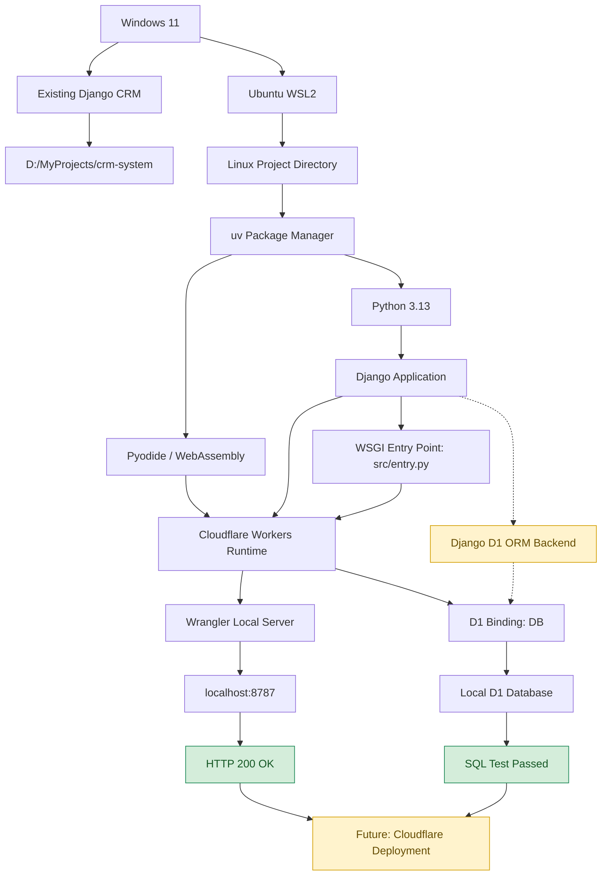
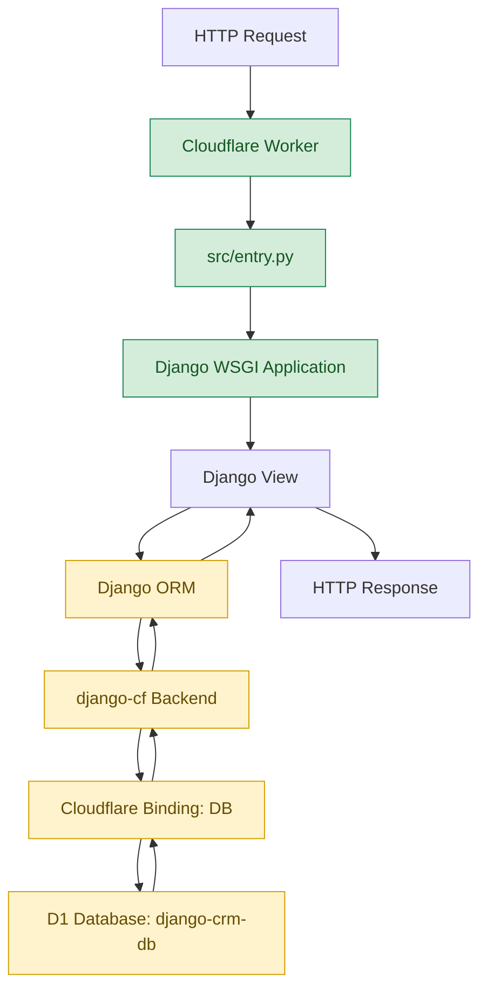

# Django on Cloudflare Workers — Setup & Troubleshooting Guide

**Environment:** Windows 11 + Ubuntu WSL2 + Python + Django + Cloudflare Workers + D1  
**Project:** `django-cloudflare-test`  
**Status:** ✅ Django local server working | ✅ D1 local SQL test passed | 🔄 Django ORM integration in progress  
**Last updated:** October 14, 2026

## Table of Contents

1. [System Architecture](#1-system-architecture)
2. [Complete Setup and Troubleshooting Flowchart](#2-complete-setup-and-troubleshooting-flowchart)
3. [Development Environment](#3-development-environment)
4. [Installation Commands](#4-installation-commands)
5. [Troubleshooting Reference](#5-troubleshooting-reference)
6. [Successful Test Results](#6-successful-test-results)
7. [Cloudflare D1 and Django ORM Integration](#7-cloudflare-d1-and-django-orm-integration)
8. [Next Steps — CRM Integration and Deployment](#8-next-steps--crm-integration-and-deployment)

---

## 1. System Architecture

The development environment uses Windows 11 for the original Django CRM project and Ubuntu WSL2 for the Cloudflare Workers development runtime.



### Current architecture

| Layer | Technology | Status |
|---|---|---|
| Operating system | Windows 11 | Working |
| Linux development | Ubuntu WSL2 | Working |
| Python package manager | uv | Working |
| Python runtime | Python 3.13 / Pyodide | Working |
| Web framework | Django | Working locally |
| Worker entry point | WSGI via `src/entry.py` | Verified |
| Cloudflare development server | Wrangler | Working |
| Database service | Cloudflare D1 | Created |
| Local database SQL | Wrangler D1 commands | Tested |
| Django D1 backend | `django-cf` 0.2.17 | Installed and configured |
| Django ORM CRUD | Django models and queries | Not yet tested |
| Public deployment | Cloudflare Workers | Not yet deployed |

**Important:** The D1 database exists and local SQL operations have succeeded. However, Django ORM connectivity has not yet been verified.

[⬆ Back to Table of Contents](#table-of-contents)

---

## 2. Complete Setup and Troubleshooting Flowchart

This diagram records the actual development process, problems encountered, solutions, and current progress.

```mermaid
flowchart TD
    START(["Start: Django on Cloudflare"]) --> NODE{"Node.js version >= 22?"}

    NODE -->|No: Node v20| NODEFIX["Upgrade Node.js"]
    NODEFIX --> NODE

    NODE -->|Yes| INIT["Create Django Cloudflare test project"]

    INIT --> TYPO{"Correct command syntax?"}
    TYPO -->|No| TYPOFIX["Use workers-py, not workers -py"]
    TYPOFIX --> INIT

    TYPO -->|Yes| PROJECT["Project created"]

    PROJECT --> UV["Install Python dependencies"]
    UV --> WHEEL{"Installation completed?"}

    WHEEL -->|Slow or apparently frozen| COPY["Use copy mode and verbose logs"]
    COPY --> WAIT["Wait for installation"]
    WAIT --> CHECK{"Django installed?"}

    CHECK -->|No| UV
    CHECK -->|Yes| WINRUN["Run pywrangler on Windows"]

    WHEEL -->|Yes| WINRUN

    WINRUN --> PYODIDE{"Pyodide initialized?"}

    PYODIDE -->|No: ModuleNotFoundError| WSL["Switch to Ubuntu WSL2"]
    PYODIDE -->|Yes| TEST["Open localhost:8787"]

    WSL --> WSLNODE{"Node.js installed?"}
    WSLNODE -->|No| NVM["Install Node.js 24 with nvm"]
    NVM --> WSLNODE

    WSLNODE -->|Yes| WSLUV{"uv installed?"}
    WSLUV -->|No| UVFIX["Install uv in Ubuntu"]
    UVFIX --> WSLUV

    WSLUV -->|Yes| MOUNT{"Windows D: drive accessible?"}
    MOUNT -->|No| MOUNTFIX["Mount D: with drvfs"]
    MOUNTFIX --> MOUNT

    MOUNT -->|Yes| COPYPROJECT["Copy project into Ubuntu"]
    COPYPROJECT --> INSTALL["Install Python 3.13 and dependencies"]
    INSTALL --> RUN["Run pywrangler dev"]
    RUN --> TEST

    TEST --> HTTP{"HTTP 200 OK?"}
    HTTP -->|No| LOGS["Inspect Wrangler logs"]
    LOGS --> RUN
    HTTP -->|Yes| SUCCESS["Django local server working"]

    SUCCESS --> D1["Create django-crm-db"]
    D1 --> BIND["Configure DB binding"]
    BIND --> SQL["Execute local D1 SQL"]
    SQL --> SQLTEST{"Insert and SELECT work?"}

    SQLTEST -->|No| SQLFIX["Check database name and local flag"]
    SQLFIX --> SQL
    SQLTEST -->|Yes| D1SUCCESS["D1 SQL test passed"]

    D1SUCCESS --> BACKEND["Install django-cf 0.2.17"]
    BACKEND --> SETTINGS["Configure Django DATABASES"]
    SETTINGS --> ENTRY["Verify src/entry.py uses WSGI"]
    ENTRY --> ORM["Next: Django ORM and migrations"]
    ORM --> DEPLOY["Future: Cloud deployment"]

    classDef error fill:#f8d7da,stroke:#dc3545,color:#842029
    classDef success fill:#d4edda,stroke:#198754,color:#155724
    classDef future fill:#fff3cd,stroke:#d39e00,color:#664d03

    class TYPOFIX,COPY,MOUNTFIX,SQLFIX error
    class SUCCESS,D1SUCCESS success
    class ORM,DEPLOY future
```



[⬆ Back to Table of Contents](#table-of-contents)

---

## 3. Development Environment

### Windows environment

| Component | Version / Location |
|---|---|
| Operating system | Windows 11 |
| Project root | `D:\MyProjects` |
| Existing CRM | `D:\MyProjects\crm-system` |
| Cloudflare test project | `D:\MyProjects\django-cloudflare-test` |
| Windows Python | 3.13.7 |
| Windows uv | 0.13.0 |
| Node.js after upgrade | 24.x |
| WSL distribution | Ubuntu, WSL2 |

### Ubuntu environment

| Component | Version / Location |
|---|---|
| Ubuntu Python | 3.14.4 |
| Project Python | 3.13, managed by uv |
| Node.js | 24.21.0 |
| npm | 11.19.0 |
| Wrangler | 4.149.0 |
| Django in generated test project | 6.1.2 |
| Django Cloudflare backend | `django-cf` 0.2.17 |
| Project location | `/home/potatoscript/projects/django-cloudflare-test` |
| Development URL | `http://localhost:8787` |
| D1 database name | `django-crm-db` |
| D1 binding name | `DB` |

The original CRM uses Django 5.2. Its compatibility with the Cloudflare runtime must be tested separately.

[⬆ Back to Table of Contents](#table-of-contents)

---

## 4. Installation Commands

### 4.1 Create the project on Windows

Upgrade Node.js if necessary:

```cmd
winget upgrade --id OpenJS.NodeJS.LTS -e
```

Verify:

```cmd
node --version
npm --version
```

Create the Django Cloudflare test project:

```cmd
cd /d D:\MyProjects

uv run --with workers-py pywrangler init django-cloudflare-test --template https://github.com/cloudflare/python-workers-examples/tree/main/django
```

During initialization:

- Choose **Yes** to create `AGENTS.md`.
- Choose **Yes** to initialize Git.
- Do not deploy yet.

### 4.2 Start Ubuntu WSL2

From Windows Command Prompt:

```cmd
wsl -l -v
wsl -d Ubuntu
```

Verify Ubuntu is running:

```bash
pwd
```

### 4.3 Install Node.js in Ubuntu

Install prerequisites:

```bash
sudo apt update
sudo apt install -y curl ca-certificates
```

Install nvm:

```bash
curl -o- https://raw.githubusercontent.com/nvm-sh/nvm/v0.40.3/install.sh | bash
```

Load nvm:

```bash
export NVM_DIR="$HOME/.nvm"
[ -s "$NVM_DIR/nvm.sh" ] && . "$NVM_DIR/nvm.sh"
```

Install Node.js 24:

```bash
nvm install 24
```

Verify:

```bash
node --version
npm --version
```

### 4.4 Install uv in Ubuntu

```bash
curl -LsSf https://astral.sh/uv/install.sh | sh
source ~/.local/bin/env
uv --version
```

### 4.5 Mount the Windows D: drive

Check:

```bash
ls /mnt/d
```

If the directory does not exist:

```bash
sudo mkdir -p /mnt/d
sudo mount -t drvfs D: /mnt/d
```

Verify:

```bash
ls /mnt/d/MyProjects
```

### 4.6 Copy the Cloudflare project to Ubuntu

Create the destination:

```bash
mkdir -p ~/projects/django-cloudflare-test
cd ~/projects/django-cloudflare-test
```

Copy source files while excluding Windows-generated environments:

```bash
tar -C /mnt/d/MyProjects/django-cloudflare-test \
  --exclude=.venv \
  --exclude=.venv-workers \
  --exclude=node_modules \
  --exclude=.git \
  -cf - . | tar -xf -
```

Verify:

```bash
ls -la
```

Expected project files include:

```text
django-cloudflare-test/
├── AGENTS.md
├── README.md
├── package.json
├── package-lock.json
├── pyproject.toml
├── uv.lock
├── wrangler.jsonc
└── src/
```

### 4.7 Install Python dependencies

```bash
uv python install 3.13
uv sync --python 3.13
```

### 4.8 Start the Cloudflare development server

```bash
uv run --with workers-py pywrangler dev
```

Open:

http://localhost:8787

**Expected response:**

```json
{
  "message": "Hello from Django on Cloudflare Workers!"
}
```

[⬆ Back to Table of Contents](#table-of-contents)

---

## 5. Troubleshooting Reference

### Error 1 — Incorrect command syntax

**Error:**

```text
No interpreter found for executable name `y`
```

**Cause:** Accidentally entered `workers -py` with a space.

**Incorrect:**

```bash
uv run --with workers -py pywrangler init
```

**Correct:**

```bash
uv run --with workers-py pywrangler init
```

### Error 2 — Node.js version too old

**Error:**

```text
create-cloudflare requires at least Node.js v22.0.0
You are using v20.20.0
```

**Solution:** Upgrade Node.js to version 22 or newer.

On Windows:

```cmd
winget upgrade --id OpenJS.NodeJS.LTS -e
```

Restart the terminal and verify:

```cmd
node --version
```

### Error 3 — Hardlink warning during installation

**Warning:**

```text
Failed to hardlink files; falling back to full copy.
```

**Cause:** uv could not use hard links between its cache and the target virtual environment.

**Solution:**

```cmd
set UV_LINK_MODE=copy
```

Or:

```cmd
uv sync --link-mode copy
```

This warning is not fatal. Copy mode may be slower.

### Error 4 — Installation appears stuck at `Installing wheels`

**Example:**

```text
[13/14] tzdata==2026.5
```

Or:

```text
[0/1] Installing wheels...
```

**Investigation:**

```cmd
uv sync --offline --link-mode copy -vv
```

The verbose logs eventually showed:

```text
TRACE Extracting wheel files name=PackageName("django")
TRACE Writing record name=PackageName("django")
Installed 1 package in 2m 31s
+ django==6.1.2
```

**Lesson:** A large Python package installation may appear frozen while files are being extracted and installed. Wait for completion and inspect verbose output before assuming failure.

### Error 5 — Pyodide runtime fails on Windows

**Error:**

```text
ModuleNotFoundError: No module named 'python'
```

During:

```text
.venv-workers
pyodide-3.13.2-emscripten-wasm32-musl
```

**Cause:** The Windows Cloudflare development environment could not successfully initialize or inspect its Pyodide interpreter. The exact underlying cause was not established.

**Attempted repair:**

```cmd
uv python install pyodide-3.13.2-emscripten-wasm32-musl --reinstall
```

This failed with:

```text
No download found for request
```

**Working alternative:** Run the project inside Ubuntu WSL2. This successfully initialized Pyodide and started Wrangler.

### Error 6 — Node.js not found in Ubuntu

**Error:**

```text
node: command not found
```

**Cause:** Windows and Ubuntu maintain separate development environments.

**Solution:** Install Node.js inside Ubuntu using nvm.

```bash
nvm install 24
```

### Error 7 — uv not found in Ubuntu

**Error:**

```text
uv: command not found
```

**Solution:**

```bash
curl -LsSf https://astral.sh/uv/install.sh | sh
source ~/.local/bin/env
```

### Error 8 — Windows D: drive unavailable

**Error:**

```text
ls: cannot access '/mnt/d': No such file or directory
```

**Solution:**

```bash
sudo mkdir -p /mnt/d
sudo mount -t drvfs D: /mnt/d
```

Verify:

```bash
ls /mnt/d/MyProjects
```

### Error 9 — tar cannot find source directory

**Error:**

```text
tar: /mnt/d/MyProjects/django-cloudflare-test:
Cannot open: No such file or directory
```

**Cause:** The Windows D: drive was not mounted in Ubuntu.

**Solution:** Mount the drive first, verify the directory exists, and repeat the copy command.

### Error 10 — favicon.ico returns 404

**Log:**

```text
GET /favicon.ico 404 Not Found
```

**Cause:** The browser requested a favicon that the Django example does not provide.

**Action:** No action required for the test project. Add a favicon later if desired.

### Error 11 — Cloudflare entry point file not found

**Error:**

```text
cat: src/index.py: No such file or directory
```

**Cause:** The generated project uses `src/entry.py` instead of `src/index.py`.

**Solution:**

```bash
find src -name "entry.py"
cat src/entry.py
```

The confirmed entry point is `src/entry.py`.

### Error 12 — D1 configuration grep returns no output

**Incorrect command:**

```bash
grep -n -A 7 '"d1_database"' wrangler.jsonc
```

**Cause:** The Wrangler configuration property is `d1_databases`, plural.

**Correct command:**

```bash
grep -n -A 8 '"d1_databases"' wrangler.jsonc
```

If no output appears, inspect the complete file:

```bash
cat wrangler.jsonc
```

### Error 13 — Django database backend cannot be imported

**Possible error:**

```text
ModuleNotFoundError: No module named 'django_cf'
```

**Check whether the package is installed:**

```bash
uv pip show django-cf
```

**Install if missing:**

```bash
uv add django-cf
```

This is a troubleshooting reference; this particular error has not occurred in the current project.

[⬆ Back to Table of Contents](#table-of-contents)

---

## 6. Successful Test Results

### 6.1 Django local server

**Terminal output:**

```text
wrangler 4.149.0

Packages installed in python_modules.
Packages installed in .venv-workers.

Ready on http://localhost:8787

GET / 200 OK (194ms)
GET /favicon.ico 404 Not Found
```

**Browser response:**

```json
{
  "message": "Hello from Django on Cloudflare Workers!"
}
```

### 6.2 Cloudflare D1 SQL test

Created the test table:

```bash
npx wrangler d1 execute django-crm-db --local --command "CREATE TABLE IF NOT EXISTS connection_test (id INTEGER PRIMARY KEY, message TEXT NOT NULL)"
```

Inserted a record:

```bash
npx wrangler d1 execute django-crm-db --local --command "INSERT INTO connection_test (message) VALUES ('Django Cloudflare D1 test')"
```

Retrieved the record:

```bash
npx wrangler d1 execute django-crm-db --local --command "SELECT * FROM connection_test"
```

**Confirmed result:** The SQL query returned the inserted message.

```text
Django Cloudflare D1 test
```

This proves that local D1 SQL operations work. It does not yet prove Django's ORM can access the database.

### 6.3 Verified milestones

| Milestone | Status |
|---|---|
| Ubuntu WSL2 starts | Complete |
| Node.js works in Ubuntu | Complete |
| uv installs Python dependencies | Complete |
| Pyodide initializes | Complete |
| Django returns HTTP 200 | Complete |
| Cloudflare D1 database created | Complete |
| Local D1 SQL insert/select | Complete |
| `django-cf` installed | Complete |
| Django D1 settings configured | Complete |
| WSGI entry point inspected | Complete |
| D1 binding configuration rechecked | Pending |
| Django ORM CRUD tested | Pending |
| Cloudflare public deployment | Pending |

[⬆ Back to Table of Contents](#table-of-contents)

---

## 7. Cloudflare D1 and Django ORM Integration

### 7.1 Create a Cloudflare D1 database

From Ubuntu:

```bash
cd ~/projects/django-cloudflare-test
```

Authenticate with Cloudflare:

```bash
npx wrangler login
```

Create the database:

```bash
npx wrangler d1 create django-crm-db --binding DB --update-config
```

The database name is:

```text
django-crm-db
```

The Cloudflare Worker binding is:

```text
DB
```

### 7.2 Check `wrangler.jsonc`

**File:** `wrangler.jsonc`

Expected configuration section:

```json
"d1_databases": [
  {
    "binding": "DB",
    "database_name": "django-crm-db",
    "database_id": "YOUR_ACTUAL_DATABASE_ID"
  }
]
```

The actual database ID is generated by Cloudflare.

Check the configuration:

```bash
grep -n -A 8 '"d1_databases"' wrangler.jsonc
```

**Status:** Database creation and SQL operations succeeded. The final configuration verification is still pending.

### 7.3 Install the Django Cloudflare backend

```bash
uv add django-cf
```

Verify:

```bash
uv pip show django-cf
```

**Actual result:**

```text
Name: django-cf
Version: 0.2.17
Location: /home/potatoscript/projects/django-cloudflare-test/.venv/lib/python3.13/site-packages
Requires: sqlparse, workers-runtime-sdk
```

**Status:** Successfully installed.

### 7.4 Configure Django to use D1

**File:** `src/hello_django/settings.py`

The current database configuration is:

```python
DATABASES = {
    "default": {
        "ENGINE": "django_cf.db.backends.d1",
        "CLOUDFLARE_BINDING": "DB",
    }
}
```

Verify:

```bash
grep -n -A 7 'DATABASES' src/hello_django/settings.py
```

**Actual result:**

```text
9:DATABASES = {
10-     "default":{
11-             "ENGINE": "django_cf.db.backends.d1",
12-             "CLOUDFLARE_BINDING": "DB",
13-     }
14-}
```

**Status:** Successfully configured.

### 7.5 Verify the Django Worker entry point

**File:** `src/entry.py`

The project uses WSGI rather than ASGI.

Actual file contents:

```python
import os

from workers import WorkerEntrypoint, wsgi

os.environ.setdefault("DJANGO_SETTINGS_MODULE", "hello_django.settings")

from hello_django.wsgi import application


class Default(WorkerEntrypoint):
    async def fetch(self, request):
        return await wsgi.fetch(application, request, self.env)
```

The entry point performs these operations:

1. Imports the Cloudflare Workers runtime.
2. Sets the Django settings module.
3. Imports Django's WSGI application.
4. Defines the Worker entry point.
5. Forwards incoming HTTP requests to Django.
6. Passes Cloudflare environment bindings through `self.env`.

**Status:** Verified. No changes required.

### 7.6 D1 connection flow



The Django ORM portion of this flow is the intended architecture and remains to be tested.

### 7.7 Next test — Django Customer model

The planned model is:

```python
from django.db import models


class Customer(models.Model):
    name = models.CharField(max_length=100)
    email = models.EmailField()

    def __str__(self):
        return self.name
```

Planned ORM operations:

```python
Customer.objects.create(
    name="Cloudflare Test Customer",
    email="test@example.com"
)
```

```python
Customer.objects.all()
```

These examples have **not yet been executed**.

Before running migrations, confirm the supported migration workflow for the installed D1 backend. Cloudflare D1 has transaction limitations, and standard Django migration behavior should not be assumed to work unchanged.

[⬆ Back to Table of Contents](#table-of-contents)

---

## 8. Next Steps — CRM Integration and Deployment

### Phase 1 — Complete Django ORM integration

- [x] Create D1 database
- [x] Test local SQL operations
- [x] Install `django-cf`
- [x] Configure Django database settings
- [x] Verify the WSGI entry point
- [ ] Verify `DB` binding in `wrangler.jsonc`
- [ ] Restart Django with the D1 configuration
- [ ] Create a test Django app and Customer model
- [ ] Generate and apply compatible migrations
- [ ] Test Django ORM create, read, update, and delete

### Phase 2 — Integrate the existing CRM

- [ ] Review the existing Django 5.2 CRM project
- [ ] Verify compatibility with the Cloudflare Django runtime
- [ ] Migrate Customer functionality
- [ ] Migrate Contact functionality
- [ ] Migrate Opportunity functionality
- [ ] Migrate Activity functionality
- [ ] Test relationships, forms, search, and pagination
- [ ] Configure authentication and access control

### Phase 3 — Deploy to Cloudflare

- [ ] Configure production settings and secrets
- [ ] Configure static assets
- [ ] Apply database schema changes to remote D1
- [ ] Deploy to a Cloudflare `workers.dev` address
- [ ] Test all CRM functions online
- [ ] Confirm the CRM works while the local PC is off
- [ ] Monitor Cloudflare free-tier usage and limits

### Important limitations

Cloudflare D1 does not support all transaction behavior expected by traditional Django database backends. Migration compatibility, Django ORM features, and free-tier resource limits must be tested before using this setup for production CRM data.

Do not use a production database for destructive tests or assume Django's test runner will automatically create an isolated D1 test database.

### Useful commands for future sessions

Start Ubuntu from Windows:

```cmd
wsl -d Ubuntu
```

Enter the project:

```bash
cd ~/projects/django-cloudflare-test
```

Verify the Django Cloudflare package:

```bash
uv pip show django-cf
```

Check Django database settings:

```bash
grep -n -A 7 'DATABASES' src/hello_django/settings.py
```

Check the D1 binding:

```bash
grep -n -A 8 '"d1_databases"' wrangler.jsonc
```

Inspect the Worker entry point:

```bash
cat src/entry.py
```

Query local D1:

```bash
npx wrangler d1 execute django-crm-db --local --command "SELECT * FROM connection_test"
```

Start the development server:

```bash
uv run --with workers-py pywrangler dev
```

Stop the development server:

```text
Ctrl+C
```

---

## Development Milestones

| Date | Achievement |
|---|---|
| October 11, 2026 | Django successfully ran locally through Cloudflare Workers on Ubuntu WSL2 |
| October 13, 2026 | Cloudflare D1 database created and local SQL operations verified |
| October 14, 2026 | `django-cf` 0.2.17 and Django D1 settings confirmed; WSGI entry point verified |

**Current milestone:** Preparing to test Django ORM operations with Cloudflare D1.

**Next milestone:** Create a Django Customer model and successfully save and retrieve data using Django ORM.
