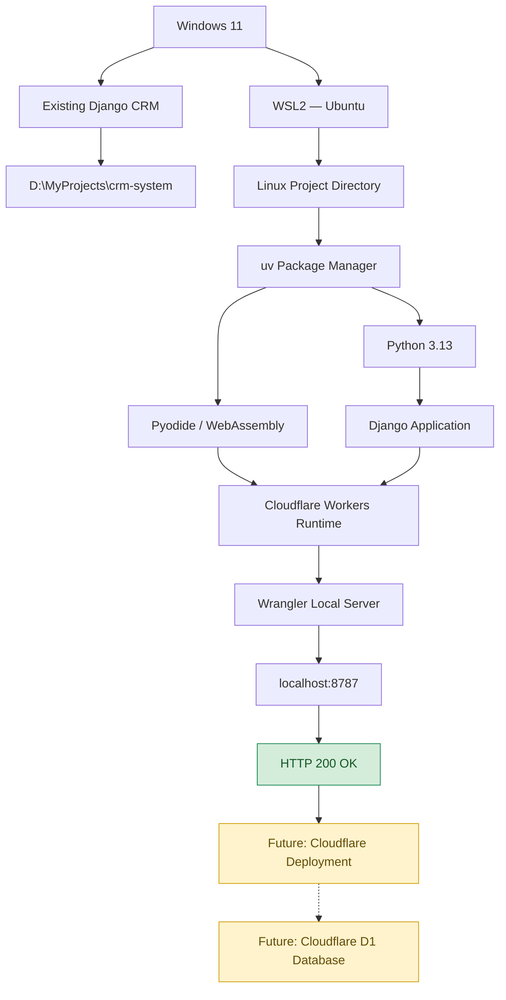
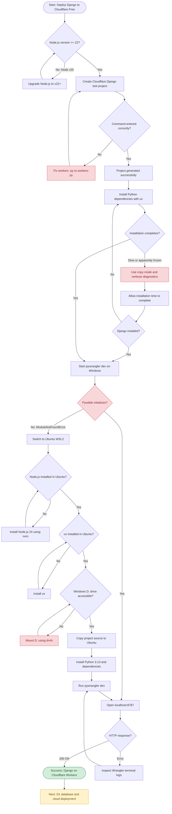

# Django on Cloudflare Workers — Setup & Troubleshooting Guide

**Environment:** Windows 11 + Ubuntu WSL2 + Python + Django + Cloudflare Workers  
**Project:** `django-cloudflare-test`  
**Status:** ✅ Local development server successfully running  
**Last updated:** October 11, 2026

## Table of Contents

1. [System Architecture](#1-system-architecture)
2. [Complete Setup and Troubleshooting Flowchart](#2-complete-setup-and-troubleshooting-flowchart)
3. [Development Environment](#3-development-environment)
4. [Installation Commands](#4-installation-commands)
5. [Troubleshooting Reference](#5-troubleshooting-reference)
6. [Successful Test Results](#6-successful-test-results)
7. [Next Steps — Cloudflare D1 and Deployment](#7-next-steps--cloudflare-d1-and-deployment)

---

## 1. System Architecture

The following diagram shows how the development environment works.



**Important:** The Django application currently runs locally inside Ubuntu using Cloudflare's development runtime. It is not yet deployed to Cloudflare's public infrastructure, and D1 is not yet connected.

[⬆ Back to Table of Contents](#table-of-contents)

---

## 2. Complete Setup and Troubleshooting Flowchart

This flowchart records the actual problems encountered and the solutions used during setup.



[⬆ Back to Table of Contents](#table-of-contents)

---

## 3. Development Environment

### Windows environment

| Component | Version / Location |
|---|---|
| Operating system | Windows |
| Project root | `D:\MyProjects` |
| Existing CRM | `D:\MyProjects\crm-system` |
| Cloudflare test project | `D:\MyProjects\django-cloudflare-test` |
| Windows Python | 3.13.7 |
| Windows uv | 0.13.0 |
| Node.js after upgrade | 24.x |
| WSL distribution | Ubuntu, WSL2 |

### Ubuntu environment

| Component | Version / Location |
|---|---|
| Ubuntu Python | 3.14.4 |
| Project Python | 3.13, managed by uv |
| Node.js | 24.21.0 |
| npm | 11.19.0 |
| Wrangler | 4.149.0 |
| Django in generated test project | 6.1.2 |
| Project location | `/home/potatoscript/projects/django-cloudflare-test` |
| Development URL | `http://localhost:8787` |

The original CRM uses Django 5.2. Its compatibility with the Cloudflare runtime must be tested separately.

[⬆ Back to Table of Contents](#table-of-contents)

---

## 4. Installation Commands

### 4.1 Create the project on Windows

Upgrade Node.js if necessary:

```cmd
winget upgrade --id OpenJS.NodeJS.LTS -e
```

Verify:

```cmd
node --version
npm --version
```

Create the Django Cloudflare test project:

```cmd
cd /d D:\MyProjects

uv run --with workers-py pywrangler init django-cloudflare-test --template https://github.com/cloudflare/python-workers-examples/tree/main/django
```

During initialization:

- Choose **Yes** to create `AGENTS.md`.
- Choose **Yes** to initialize Git.
- Do not deploy yet.

### 4.2 Start Ubuntu WSL2

From Windows Command Prompt:

```cmd
wsl -l -v
wsl -d Ubuntu
```

Verify Ubuntu is running:

```bash
pwd
```

### 4.3 Install Node.js in Ubuntu

Install prerequisites:

```bash
sudo apt update
sudo apt install -y curl ca-certificates
```

Install nvm:

```bash
curl -o- https://raw.githubusercontent.com/nvm-sh/nvm/v0.40.3/install.sh | bash
```

Load nvm:

```bash
export NVM_DIR="$HOME/.nvm"
[ -s "$NVM_DIR/nvm.sh" ] && . "$NVM_DIR/nvm.sh"
```

Install Node.js 24:

```bash
nvm install 24
```

Verify:

```bash
node --version
npm --version
```

### 4.4 Install uv in Ubuntu

```bash
curl -LsSf https://astral.sh/uv/install.sh | sh
source ~/.local/bin/env
uv --version
```

### 4.5 Mount the Windows D: drive

Check:

```bash
ls /mnt/d
```

If the directory does not exist:

```bash
sudo mkdir -p /mnt/d
sudo mount -t drvfs D: /mnt/d
```

Verify:

```bash
ls /mnt/d/MyProjects
```

### 4.6 Copy the Cloudflare project to Ubuntu

Create the destination:

```bash
mkdir -p ~/projects/django-cloudflare-test
cd ~/projects/django-cloudflare-test
```

Copy source files while excluding Windows-generated environments:

```bash
tar -C /mnt/d/MyProjects/django-cloudflare-test \
  --exclude=.venv \
  --exclude=.venv-workers \
  --exclude=node_modules \
  --exclude=.git \
  -cf - . | tar -xf -
```

Verify:

```bash
ls -la
```

Expected project files include:

```text
django-cloudflare-test/
├── AGENTS.md
├── README.md
├── package.json
├── package-lock.json
├── pyproject.toml
├── uv.lock
├── wrangler.jsonc
└── src/
```

### 4.7 Install Python dependencies

```bash
uv python install 3.13
uv sync --python 3.13
```

### 4.8 Start the Cloudflare development server

```bash
uv run --with workers-py pywrangler dev
```

Open:

http://localhost:8787

**Expected response:**

```json
{
  "message": "Hello from Django on Cloudflare Workers!"
}
```

[⬆ Back to Table of Contents](#table-of-contents)

---

## 5. Troubleshooting Reference

### Error 1 — Incorrect command syntax

**Error:**

```text
No interpreter found for executable name `y`
```

**Cause:** Accidentally entered `workers -py` with a space.

**Incorrect:**

```bash
uv run --with workers -py pywrangler init
```

**Correct:**

```bash
uv run --with workers-py pywrangler init
```

### Error 2 — Node.js version too old

**Error:**

```text
create-cloudflare requires at least Node.js v22.0.0
You are using v20.20.0
```

**Solution:** Upgrade Node.js to version 22 or newer.

On Windows:

```cmd
winget upgrade --id OpenJS.NodeJS.LTS -e
```

Restart the terminal and verify:

```cmd
node --version
```

### Error 3 — Hardlink warning during installation

**Warning:**

```text
Failed to hardlink files; falling back to full copy.
```

**Cause:** uv could not use hard links between its cache and the target virtual environment.

**Solution:**

```cmd
set UV_LINK_MODE=copy
```

Or:

```cmd
uv sync --link-mode copy
```

This warning is not fatal. Copy mode may be slower.

### Error 4 — Installation appears stuck at `Installing wheels`

**Example:**

```text
[13/14] tzdata==2026.5
```

Or:

```text
[0/1] Installing wheels...
```

**Investigation:**

```cmd
uv sync --offline --link-mode copy -vv
```

The verbose logs eventually showed:

```text
TRACE Extracting wheel files name=PackageName("django")
TRACE Writing record name=PackageName("django")
Installed 1 package in 2m 31s
+ django==6.1.2
```

**Lesson:** A large Python package installation may appear frozen while files are being extracted and installed. Wait for completion and inspect verbose output before assuming failure.

### Error 5 — Pyodide runtime fails on Windows

**Error:**

```text
ModuleNotFoundError: No module named 'python'
```

During:

```text
.venv-workers
pyodide-3.13.2-emscripten-wasm32-musl
```

**Cause:** The Windows Cloudflare development environment could not successfully initialize or inspect its Pyodide interpreter. The exact underlying cause was not established.

**Attempted repair:**

```cmd
uv python install pyodide-3.13.2-emscripten-wasm32-musl --reinstall
```

This failed with:

```text
No download found for request
```

**Working alternative:** Run the project inside Ubuntu WSL2. This successfully initialized Pyodide and started Wrangler.

### Error 6 — Node.js not found in Ubuntu

**Error:**

```text
node: command not found
```

**Cause:** Windows and Ubuntu maintain separate development environments.

**Solution:** Install Node.js inside Ubuntu using nvm.

```bash
nvm install 24
```

### Error 7 — uv not found in Ubuntu

**Error:**

```text
uv: command not found
```

**Solution:**

```bash
curl -LsSf https://astral.sh/uv/install.sh | sh
source ~/.local/bin/env
```

### Error 8 — Windows D: drive unavailable

**Error:**

```text
ls: cannot access '/mnt/d': No such file or directory
```

**Solution:**

```bash
sudo mkdir -p /mnt/d
sudo mount -t drvfs D: /mnt/d
```

Verify:

```bash
ls /mnt/d/MyProjects
```

### Error 9 — tar cannot find source directory

**Error:**

```text
tar: /mnt/d/MyProjects/django-cloudflare-test:
Cannot open: No such file or directory
```

**Cause:** The Windows D: drive was not mounted in Ubuntu.

**Solution:** Mount the drive first, verify the directory exists, and repeat the copy command.

### Error 10 — favicon.ico returns 404

**Log:**

```text
GET /favicon.ico 404 Not Found
```

**Cause:** The browser requested a favicon that the Django example does not provide.

**Action:** No action required for the test project. Add a favicon later if desired.

[⬆ Back to Table of Contents](#table-of-contents)

---

## 6. Successful Test Results

### Terminal output

```text
wrangler 4.149.0

Packages installed in python_modules.
Packages installed in .venv-workers.

Ready on http://localhost:8787

GET / 200 OK (194ms)
GET /favicon.ico 404 Not Found
```

### Browser response

```json
{
  "message": "Hello from Django on Cloudflare Workers!"
}
```

### What has been verified

- Ubuntu WSL2 starts successfully.
- Node.js and npm work in Ubuntu.
- uv installs and manages Python dependencies.
- The Django test application loads.
- Cloudflare's Pyodide environment initializes.
- Wrangler starts a local development server.
- The browser receives a successful HTTP 200 response.

**Result:** Django successfully runs in the local Cloudflare Workers development environment.

[⬆ Back to Table of Contents](#table-of-contents)

---

## 7. Next Steps — Cloudflare D1 and Deployment

The following work remains:

1. Create a separate D1 database named `django-crm-db`.
2. Configure a D1 binding in `wrangler.jsonc`.
3. Add and test a compatible Django D1 database backend.
4. Test database migrations and CRUD operations.
5. Integrate the existing CRM models, views, forms, URLs, and templates.
6. Configure production security, authentication, and static files.
7. Deploy to a Cloudflare `workers.dev` address.
8. Verify the deployed application works while the local PC is switched off.

**Important limitations:** A successful local Django test does not guarantee that the complete CRM will fit within Cloudflare's free-tier CPU limits or that all Django ORM features will work with D1. Those need separate testing.

### Useful commands for future sessions

Start Ubuntu from Windows:

```cmd
wsl -d Ubuntu
```

Enter the project:

```bash
cd ~/projects/django-cloudflare-test
```

Start the development server:

```bash
uv run --with workers-py pywrangler dev
```

Stop the development server:

```text
Ctrl+C
```

---

**Milestone completed:** Django running locally through Cloudflare Workers on Ubuntu WSL2 — October 11, 2026.
